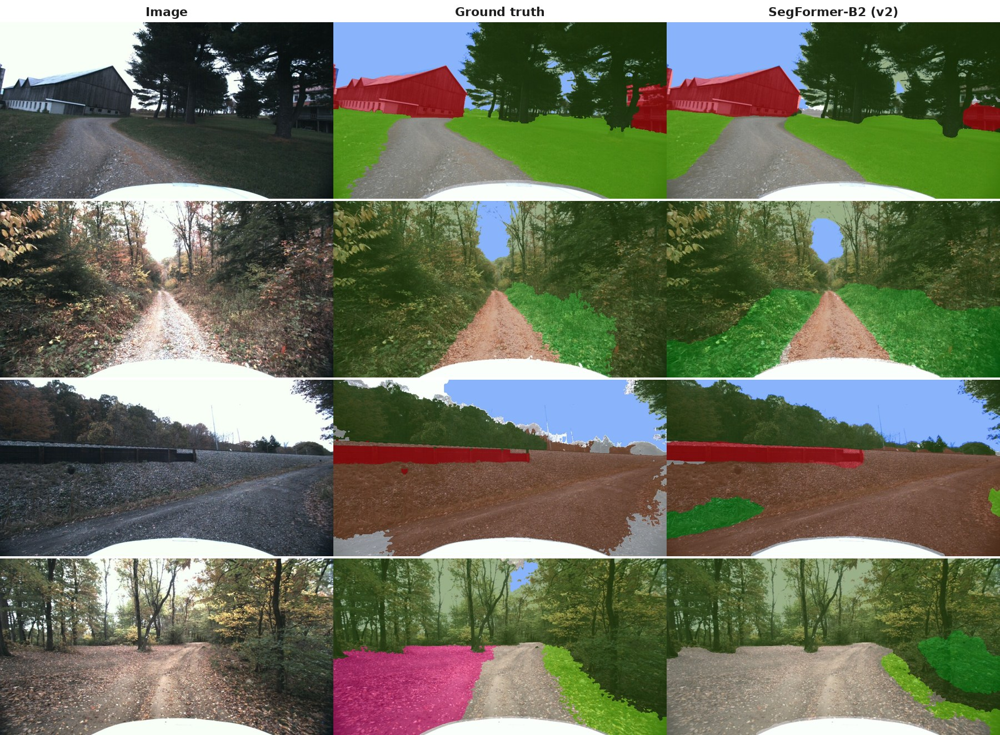
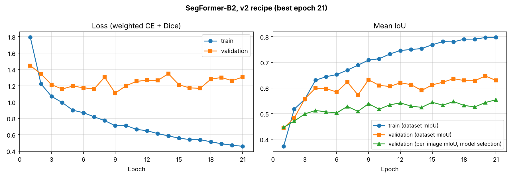

# Off-Road Terrain Segmentation

Semantic segmentation of off-road driving scenes into 9 terrain classes (sky, rough and smooth trail, traversable
grass, high and low vegetation, puddle, obstacle, background) on the
[Yamaha-CMU Off-Road dataset](https://www.ri.cmu.edu/app/uploads/2017/11/semantic-mapping-offroad-nav-compressed.pdf)
(YCOR), for terrain understanding on an autonomous vehicle. Training is constrained to **5 GB of GPU memory**.

The repository contains the original course project (a ResNet34 + U-Net, *baseline*) and a revised version
(*v2*) that fixes the evaluation protocol and replaces the network with a SegFormer-B2, improving the per-image mIoU
on the official YCOR validation set from **0.452 to 0.520**.

<p align="center"></p>
<p align="center"><sub>YCOR validation images, never seen in training. The last row is a failure case: the leaf-covered
ground annotated as <i>puddle</i> (magenta) is predicted as trail.</sub></p>

## Results

Official YCOR validation set (145 images, never used for training or model selection), at the original resolution
of 1024×544:

| Model | Recipe | mIoU per image | mIoU (dataset) | Training memory | Inference (T4) |
|---|---|---|---|---|---|
| ResNet34 + U-Net | baseline (course project) | 0.452 | 0.502 | — | 29 FPS, 0.19 GB |
| ResNet34 + U-Net | v2 | 0.439 | — | — | — |
| **SegFormer-B2** | **v2, mixed precision** | **0.520** | **0.525** | **4.77 GB** | 13 FPS, 0.64 GB |

*mIoU per image* is the project metric: IoU per class on each image (classes absent from both prediction and ground
truth are skipped), averaged over the classes of the image and then over the images. *mIoU (dataset)* accumulates
intersections and unions over the whole set. FPS are measured with batch 1, including pre- and post-processing.

Per-class IoU (per image) on YCOR:

| | sky | rough trail | smooth trail | trav. grass | high veg. | low veg. | puddle | obstacle |
|---|---|---|---|---|---|---|---|---|
| Baseline | 0.817 | 0.186 | 0.398 | 0.363 | 0.788 | 0.162 | 0.000 | 0.382 |
| SegFormer-B2 (v2) | 0.828 | 0.297 | 0.435 | 0.458 | 0.797 | 0.170 | 0.000 | 0.425 |

The gain comes from the classes that are hard to tell apart (rough vs smooth trail, grass, obstacles). *Puddle*
stays at 0: it appears in only 2 of the 145 YCOR images and in few training images, and its annotations are not
always consistent (see the last example above).

With the same v2 recipe the ResNet34 + U-Net does not improve over the baseline on YCOR: the improvement comes from
the architecture, while the v2 recipe makes the validation score a reliable estimate (below).

## What changed in v2

**Evaluation.** Consecutive frames of the same drive are almost identical, and the baseline's random (stratified)
split put near-duplicates of training images in the validation set. The baseline scores 0.494 per-image mIoU on its
own validation split but 0.617 on the v2 split, because many v2 validation images are near-copies of images it was
trained on, and 0.452 on YCOR. v2 uses a **scene-aware split** (717 / 179 images) in which near-duplicate frames never
cross the split, so the validation score (0.553 for SegFormer-B2) is in line with the result on unseen data.

**Training recipe.**

| | baseline | v2 |
|---|---|---|
| Split | stratified on the dominant class | scene-aware (near-duplicates grouped) |
| Augmentation | offline, 344 extra samples of rare classes | online, at every epoch |
| Loss | cross-entropy, inverse-frequency class weights | cross-entropy (inverse-sqrt weights) + Dice |
| Model selection / early stopping | dataset mIoU / validation loss | per-image mIoU (the project metric) |
| Optimizer | Adam, lr 5e-5, 20 epochs | AdamW, lr 1e-4 (6e-5 for SegFormer), up to 40 epochs, patience 8 |

**Model.** SegFormer-B2 (hierarchical Transformer encoder with a lightweight MLP decoder), initialised from the
Cityscapes weights of [NVIDIA](https://arxiv.org/abs/2105.15203). Without mixed precision its training needs 6.6 GB;
with automatic mixed precision (`--amp`) the peak is 4.77 GB, within the 5 GB limit, with the same accuracy
(0.523 vs 0.520 per-image mIoU on YCOR).

<p align="center"></p>

The validation loss stops decreasing after a few epochs while the per-image mIoU, used for model selection, keeps
improving slowly: the model becomes more confident on its mistakes (higher loss) while getting more pixels right.

## Repository structure

```
offroad_seg/
  config.py          classes, label colours, input size
  data.py            dataset, label decoding, stratified and scene-aware splits
  augmentation.py    offline (baseline) and online (v2) augmentation
  model.py           ResNet34 + U-Net, model factory and loading
  segformer.py       SegFormer wrapper (Hugging Face transformers)
  losses.py          weighted cross-entropy + Dice
  metrics.py         per-image and dataset IoU
  inference.py       full-resolution inference, colour masks and overlays
train.py             training (--recipe baseline|v2, --model resnet34_unet|segformer-b1|segformer-b2, --amp)
evaluate.py          metrics, per-class IoU, FPS and memory; optional example panels
predict.py           segmentation of new images
notebooks/           colab_train_evaluate.ipynb: training and evaluation on a Colab T4
```

## Usage

```bash
pip install -r requirements.txt
```

The dataset is not included. Each sample is a folder with `rgb.jpg` and the colour-coded `labels.png`, as in the
YCOR release. Trained weights are on the [Releases](../../releases) page: put them in `weights/`.

```bash
# Training (resumes automatically from <output-dir>/last.pth)
python train.py --recipe v2 --model segformer-b2 --amp --data-root data/train --output-dir outputs/v2_segformer_b2

# Evaluation on a folder of labelled samples, with example panels
python evaluate.py --weights weights/segformer_b2_v2.pth --data-root data/ycor_valid --examples-dir outputs/examples

# Segmentation of new images (colour masks and overlays)
python predict.py --weights weights/segformer_b2_v2.pth --images img1.jpg img2.jpg --output-dir predictions
```

## Authors

Group project (Group 70), MSc in Computer Engineering, University of Salerno, course *Machine Learning*:

- Raffaele Rosanova ([@RaffaeleRosanova01](https://github.com/RaffaeleRosanova01)), repository maintainer
- Matteo La Manna ([@matteolmn3](https://github.com/matteolmn3))

## License

Code: MIT, see [LICENSE](LICENSE). The SegFormer weights in the Releases are fine-tuned from NVIDIA's SegFormer and
remain subject to [its license](https://huggingface.co/nvidia/segformer-b2-finetuned-cityscapes-1024-1024)
(research and non-commercial use). The YCOR images are not redistributed; the examples above are shown for
illustration with credit to the dataset authors (Maturana et al., *Real-time Semantic Mapping for Autonomous
Off-Road Navigation*, FSR 2017).
